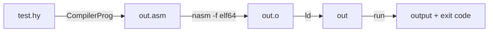
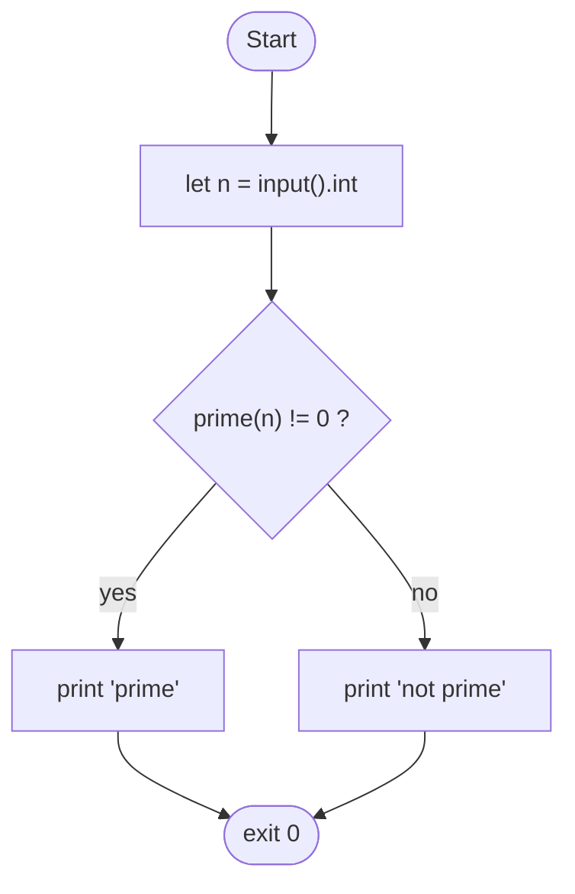
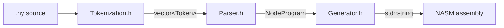

<div align="center">

# 📘 HyLang: The Complete Documentation

**Language reference · Built-in library · Cookbook · Compiler internals · Known issues**

*Compiler: `CompilerProg` · Source files: `.hy` · Target: NASM x86-64 Linux*

</div>

> This document was checked against `Tokenization.h`, `Parser.h` and `Generator.h`. The only thing not covered is `main.cpp`, which I have not seen; the single remaining `🔎 VERIFY` marker is about it.

---

## 📑 Table of Contents

1. [Introduction](#1-introduction)
2. [Getting Started](#2-getting-started)
3. [Language Tour](#3-language-tour)
4. [Statements](#4-statements)
5. [Expressions and Operators](#5-expressions-and-operators)
6. [Built-in Function Reference](#6-built-in-function-reference)
7. [Arrays](#7-arrays)
8. [Control Flow](#8-control-flow)
9. [Cookbook](#9-cookbook)
10. [Gotchas and Pitfalls](#10-gotchas-and-pitfalls)
11. [Error Reference](#11-error-reference)
12. [Compiler Internals](#12-compiler-internals)
13. [Known Issues and Fixes](#13-known-issues-and-fixes)
14. [Roadmap](#14-roadmap)
15. [Appendices](#15-appendices)

---

# 1. Introduction

## 1.1 What is HyLang?

HyLang is a small language focused on **numbers**. Where most languages push number-theory helpers into a library, HyLang makes them keywords: checking primality, summing digits and finding GCDs are one-liners. It is a **compiler**, not an interpreter: your `.hy` program becomes NASM assembly, which becomes a native Linux executable.

```text
print(gcd(48, 18));
print(prime(97));
print(digit_sum(2024));
```

Output:

```text
6
1
8
```

## 1.2 Design goals

| Goal | What it means in practice |
|---|---|
| **Tiny surface** | A handful of statements and no hidden magic |
| **Batteries included** | Common numeric tasks are built-ins |
| **Native speed** | Real machine code, no runtime |
| **Hackable** | One header per compiler stage and an `std::variant` AST |

## 1.3 A first program

```text
let radius = 5;
let area = 3 * radius * radius;
print("Approximate area: ");
print(area);
```

Output:

```text
Approximate area: 75
```

## 1.4 Who is this for?

- Learners exploring how compilers work end to end
- Anyone who wants to prototype a number puzzle quickly
- Contributors who want a small codebase to extend

---

# 2. Getting Started

## 2.1 Requirements

| Need | Why |
|---|---|
| **C++20 compiler** (GCC 11+, Clang 14+, MSVC 19.28+) | designated initializers and `std::bit_cast` |
| **CMake** | the CLion project uses it |
| **NASM** and **ld** on Linux or WSL | to assemble and link the generated code |

## 2.2 Building the compiler

In CLion, press Build. From a terminal:

```bash
cmake -S . -B cmake-build-debug
cmake --build cmake-build-debug
```

## 2.3 Compiling a program

Save as `test.hy`:

```text
print(42);
```

Compile it:

```bash
CompilerProg.exe test.hy
```

A successful compile **prints nothing and exits with code 0**. The compiler's only job is to produce assembly.

🔎 VERIFY: state which file `main.cpp` writes the assembly to (the commands below assume `out.asm`).

## 2.4 Assembling, linking and running

The generated code uses Linux syscalls (`write` = 1, `read` = 0, `exit` = 60, `clock_gettime` = 228), so run these steps on Linux or WSL:

```bash
nasm -f elf64 out.asm -o out.o
ld out.o -o out
./out
echo $?
```



## 2.5 Program structure

A program is a flat sequence of statements, executed top to bottom. There is no `main`. If you never call `exit`, the program ends with exit code 0.

## 2.6 Whitespace and layout

Spaces, tabs and newlines are interchangeable. Every statement that does not end in a `{ }` block must end with `;`.

---

# 3. Language Tour

## 3.1 Values

Everything is stored in a 64-bit register or stack slot.

| Kind | Literal | Real behaviour |
|---|---|---|
| Integer | `42` | 64-bit signed. The only type arithmetic works on. |
| String | `"text"` | Stored as an address. Only `print("literal")` prints it correctly. |
| Double | `3.14` | Parsed, then stored as its raw IEEE bit pattern. Arithmetic is integer-only, so doubles are effectively unsupported. |

## 3.2 Variables

```text
let x = 10;
let y = x + 5;
```

- Names use letters, digits and `_`, and cannot start with a digit.
- A name must be declared before use (`undeclared identifier` otherwise).
- Declaring a name **already in scope is a compile error** (`identifier already used`). This includes shadowing an outer variable inside a block.
- There is **no assignment statement** for plain variables. `x = 20;` is a syntax error.

## 3.3 Scope

Blocks (`if` bodies, `else` bodies and `for` bodies) have their own scope. Everything declared inside is popped from the stack at the closing brace, and the name becomes free again.

```text
for (i = 0 to 3) {
    let square = i * i;
    print(square);
}
let square = 7;
```

This is legal: `square` is created and destroyed on every iteration, and after the loop the name is free again. The loop variable `i` also disappears after the loop.

## 3.4 Comments

HyLang has **no comments**. The tokenizer reads `//` as two division signs and the parser rejects it. See [Known Issues](#13-known-issues-and-fixes) for a five-line fix.

## 3.5 Truthiness

`if` jumps to the else branch when the condition equals `0`. Any non-zero value is true. Comparisons, `prime`, `palindrome`, `even` and `equal` all return exactly `1` or `0`.

## 3.6 Program flow in one picture



---

# 4. Statements

## 4.1 `print`

**Syntax:** `print(expression);`

- If the expression is a **string literal**, the text is written as-is with **no trailing newline**.
- Otherwise the value is printed as a **decimal number followed by a newline**. Values are treated as unsigned (see [Known Issues](#13-known-issues-and-fixes) for negatives).

```text
print(42);
print("hi");
print(2 + 3 * 4);
```

Output:

```text
42
hi14
```

(`hi` has no newline, so `14` follows directly.)

## 4.2 `exit`

**Syntax:** `exit(expression);`

Ends the program immediately with the value as exit code (the operating system keeps the low 8 bits).

```text
if (equal(len(a), 0)) {
    exit(1);
}
exit(0);
```

## 4.3 `let` (scalar)

**Syntax:** `let name = expression;`

```text
let total = 3 + 4;
let copy = total;
```

## 4.4 `let` (array literal)

**Syntax:** `let name = [e1, e2, ...];`

```text
let primes = [2, 3, 5, 7, 11];
```

At least one element is required. `[]` gives *"empty array literal"*.

## 4.5 `let` (sized array)

**Syntax:** `let name[size];` creates `size` zeros. `size` must be an integer literal.

```text
let buffer[10];
```

## 4.6 Array element assignment

**Syntax:** `name[index] = expression;`

```text
buffer[0] = 7;
buffer[i + 1] = buffer[i] * 2;
```

## 4.7 `if` / `else`

```text
if (condition) {
    ...
} else {
    ...
}
```

Braces are mandatory. The `else` part is optional.

## 4.8 `for`

**Syntax:** `for (var = start to end) { ... }`

```text
for (i = 1 to 5) {
    print(i);
}
```

Output: `1 2 3 4` (one per line).

How it works, step by step:

1. `start` is evaluated and stored as the loop variable.
2. `end` is evaluated **once** and stored.
3. If `var >= end`, the loop stops. So **`end` is excluded**.
4. The body runs, then `var` is incremented by 1.

Consequences: you can only count **upwards**, and if `start >= end` the body never runs. The loop variable is a normal variable (you can read it, but you cannot assign to it).

## 4.9 Statement summary

| Statement | Needs `;` | Needs `{}` |
|---|:-:|:-:|
| `print` | ✅ | ❌ |
| `exit` | ✅ | ❌ |
| `let` (all forms) | ✅ | ❌ |
| array assignment | ✅ | ❌ |
| `if` / `else` | ❌ | ✅ |
| `for` | ❌ | ✅ |

---

# 5. Expressions and Operators

## 5.1 Precedence

| Level | Parser function | Operators |
|:-:|---|---|
| 1 | `parse_comparison` | `==` `!=` `<` `>` `<=` `>=` |
| 2 | `parse_additive` | `+` `-` |
| 3 | `parse_multiplicative` | `*` `/` |
| 4 | `parse_primary` | literals, identifiers, calls, `( )` |

```text
print(1 + 2 * 3);
print((1 + 2) * 3);
print(1 + 2 < 2 * 3);
```

Output: `7`, `9`, `1`.

## 5.2 Associativity

All binary operators are **left-associative**.

```text
print(10 - 3 - 2);
print(1 < 2 < 3);
```

Output: `5` and `1` (the second is `(1 < 2) < 3`).

## 5.3 Comparison operators

Each produces `1` or `0` (using signed comparison).

| Operator | Meaning |
|---|---|
| `==` / `!=` | equal / not equal |
| `<` / `>` | less / greater |
| `<=` / `>=` | less or equal / greater or equal |

## 5.4 Division

`/` is **signed integer division** that truncates toward zero (`7 / 2` is `3`). Dividing by zero crashes the program with a hardware fault.

## 5.5 Integer overflow

Arithmetic wraps around at 64 bits with no warning. `fact(21)` and larger overflow.

## 5.6 Missing operators and workarounds

| Need | Workaround |
|---|---|
| Negative number | `0 - 5` (but see the printing issue in [Known Issues](#13-known-issues-and-fixes)) |
| Remainder `a % b` | `a - (a / b) * b` |
| Parity | `even(n)` |
| Logical AND | multiply the conditions: `(a > 0) * (b > 0)` |
| Logical OR | `max((a > 0), (b > 0))` |
| Logical NOT | `equal(x, 0)` |

---

# 6. Built-in Function Reference

HyLang has three call shapes:

| Shape | Looks like | Used by |
|---|---|---|
| **Parenthesized** | `name(a, b)` | `gcd` `max` `min` `power` `random` `equal` `sqrt` `fact` `prime` `palindrome` `count_digits` `time_utc` |
| **Prefix** | `name operand` | `abs` `even` `mid_val` `digit_sum` `n_fibonacci` |
| **List** | `name a, b, c` | `sum` |

> 💡 Prefix functions take a single *primary*, and a parenthesized expression is a primary, so `abs(x - 5)` always works. Making parentheses a habit for every prefix function avoids the `abs 3 - 10` trap.

All names below are **reserved words**: you cannot use them as variable names.

---

## 6.1 `abs`

Prefix. `abs x` or `abs(x)`. Returns the absolute value.

```text
print(abs(0 - 7));
```

Output: `7`. Note: `abs 3 - 10` is `(abs 3) - 10`.

## 6.2 `sqrt`

`sqrt(x)` returns the **integer square root, rounded down** (found by binary search). For `x <= 0` it returns `0`.

```text
print(sqrt(81));
print(sqrt(80));
```

Output: `9` and `8`. Results are unreliable for very large inputs (above roughly 6 billion) because the search squares its midpoint and can overflow.

## 6.3 `power`

`power(base, exponent)` multiplies in a loop. A zero or negative exponent returns `1`.

```text
print(power(2, 10));
```

Output: `1024`.

## 6.4 `fact`

`fact(n)` returns `n!`. For `n <= 1` it returns `1`. It overflows past `fact(20)`.

```text
print(fact(5));
```

Output: `120`.

## 6.5 `gcd`

`gcd(a, b)` uses the Euclidean algorithm. Intended for non-negative values.

```text
print(gcd(48, 18));
```

Output: `6`.

## 6.6 `max` and `min`

```text
print(max(3, 9));
print(min(3, 9));
```

Output: `9` and `3`. For three values nest: `max(a, max(b, c))`.

## 6.7 `sum`

List form, no parentheses, at least two values.

```text
print(sum 1, 2, 3, 4);
```

Output: `10`. Each argument is an additive expression (`sum x * 2, y, 5` is fine).

⚠️ `sum` swallows every following `, expr`. Inside another call, wrap it: `max((sum 1, 2), 3)`.

## 6.8 `even`

Prefix. Returns **`1` if the value is even, `0` if odd**.

```text
print(even(10));
print(even(7));
```

Output: `1` and `0`.

## 6.9 `prime`

`prime(x)` returns `1` for primes and `0` otherwise (including `x < 2`). It uses trial division, which is fine for ordinary numbers.

```text
print(prime(13));
print(prime(12));
```

Output: `1` and `0`.

## 6.10 `palindrome`

Returns `1` if the decimal digits read the same in both directions, `0` otherwise. Negative numbers return `0`.

```text
print(palindrome(12321));
print(palindrome(123));
```

Output: `1` and `0`.

## 6.11 `n_fibonacci`

Prefix. Zero-indexed: `F(0) = 0`, `F(1) = 1`, `F(2) = 1`, `F(3) = 2`, and so on. Negative input returns `0`.

```text
print(n_fibonacci(10));
```

Output: `55`.

## 6.12 `digit_sum`

Prefix. Sum of decimal digits; the sign is ignored.

```text
print(digit_sum(123));
```

Output: `6`.

## 6.13 `count_digits`

`count_digits(n)` returns the number of decimal digits. `count_digits(0)` is `1`. The sign is ignored.

```text
print(count_digits(1234));
```

Output: `4`.

## 6.14 `mid_val`

Prefix. Returns **half of the value, rounded toward zero** (a signed division by 2).

```text
print(mid_val(9));
print(mid_val(10));
```

Output: `4` and `5`.

## 6.15 `equal`

`equal(a, b)` returns `1` if equal, else `0`. It is the same as `a == b`, which is often easier to read.

```text
print(equal(3, 3));
```

Output: `1`.

## 6.16 `random`

`random(low, high)` returns a random integer with **both bounds inclusive**. If `low > high` it returns `0`. It uses the CPU's `rdrand` instruction, so it needs a CPU that supports it (almost all modern x86-64 chips).

```text
let roll = random(1, 6);
print(roll);
```

## 6.17 `time_utc`

`time_utc()` takes no arguments (anything inside the parentheses is a syntax error). It returns the **current UTC time as Unix seconds** (seconds since 1970-01-01), using the `clock_gettime` syscall.

```text
print(time_utc());
```

## 6.18 `input().int`

Reads from standard input and parses a **signed decimal integer**.

```text
let age = input().int;
```

Details:

- A leading `-` is accepted.
- Parsing stops at the first non-digit (newline, space, letters).
- Empty input gives `0`.
- It performs one `read` of up to 64 bytes per call. When input is **piped** with several lines at once, the first call may consume all of them. Interactive typing works as expected.
- `.int` is required: `input()` alone gives *"expected '.' after input()"*.

## 6.19 `len`

`len(array)` returns the number of elements. The argument must be an array **name**. The value is known at compile time.

```text
let a = [5, 6, 7];
print(len(a));
```

Output: `3`.

## 6.20 Array indexing `a[i]`

See [Arrays](#7-arrays).

## 6.21 Quick reference table

| Function | Args | Result |
|---|:-:|---|
| `abs` | 1 | absolute value |
| `sqrt` | 1 | floor of square root |
| `power` | 2 | base to exponent |
| `fact` | 1 | factorial |
| `gcd` | 2 | gcd |
| `max` / `min` | 2 | maximum / minimum |
| `sum` | 2+ | total |
| `even` | 1 | 1 if even, else 0 |
| `prime` | 1 | 1/0 |
| `palindrome` | 1 | 1/0 |
| `n_fibonacci` | 1 | F(n), F(0)=0 |
| `digit_sum` | 1 | digit total |
| `count_digits` | 1 | digit count |
| `mid_val` | 1 | `x / 2` |
| `equal` | 2 | 1/0 |
| `random` | 2 | random in `[low, high]` |
| `time_utc` | 0 | Unix seconds |
| `input().int` | 0 | integer from stdin |
| `len` | 1 (array) | length |

---

# 7. Arrays

## 7.1 Memory model

An array is a run of consecutive 8-byte stack slots. `let a = [10, 20, 30];` pushes three slots; `let b[4];` pushes four zeros. The compiler remembers each array's length, so `len(a)` costs nothing at runtime and the bounds check compares against a constant.

## 7.2 Creating arrays

```text
let a = [10, 20, 30];
let b[4];
let c = [1 + 1, power(2, 3), len(a)];
```

## 7.3 Reading

```text
print(a[0]);
print(a[len(a) - 1]);
```

Output: `10` and `30`.

## 7.4 Writing

```text
a[1] = 99;
a[0] = a[1] + 1;
```

## 7.5 Looping over an array

Because `to` is exclusive, the upper bound is `len(a)`:

```text
let a = [4, 8, 15, 16, 23, 42];
for (i = 0 to len(a)) {
    print(a[i]);
}
```

## 7.6 Bounds checking

Every read and write checks `0 <= index < length`. A violation **jumps to `array_oob`, which exits with code 1** and prints nothing.

```text
let a = [1, 2, 3];
print(a[3]);
```

The program ends with exit code 1 and prints nothing.

## 7.7 Limitations

- Arrays are **one-dimensional** and contain integers
- The size in `let b[N];` must be an integer literal
- `len` takes an array name only
- No resizing, no `push`, no slices
- Arrays can't be passed around, because there are no user functions yet
- The new array's name must not already be in scope

---

# 8. Control Flow

## 8.1 Branching

```text
let score = 82;
if (score >= 90) {
    print(1);
} else {
    if (score >= 80) {
        print(2);
    } else {
        print(3);
    }
}
```

Output: `2`. There is no `else if`; nest instead.

## 8.2 Conditions can be any expression

```text
if (prime(n))           { print(n); }
if (a[0] > a[1])        { print(a[0]); }
if (equal(n, 0))        { exit(1); }
```

## 8.3 Loops

```text
for (i = 1 to 4) {
    for (j = 1 to 4) {
        print(i * j);
    }
}
```

Loops and conditionals nest freely. A nested loop must use a **different** variable name.

## 8.4 Exiting early

`exit(code);` may appear anywhere, including inside loops.

```text
for (i = 2 to 100) {
    if (prime(i) == 0) {
        exit(1);
    }
}
```

## 8.5 Counting down

There is no downward loop. Count up and subtract:

```text
for (k = 0 to 5) {
    print(4 - k);
}
```

Output: `4 3 2 1 0`.

---

# 9. Cookbook

All recipes are valid under the current compiler and show their real output.

## 9.1 Hello, world

```text
print("Hello, world!");
```

## 9.2 Prime tester

```text
let n = input().int;
print(prime(n));
```

Input `97` gives `1`.

## 9.3 Hypotenuse

```text
print(sqrt(power(3, 2) + power(4, 2)));
```

Output: `5`.

## 9.4 Factorials from 1 to 10

```text
for (i = 1 to 11) {
    print(fact(i));
}
```

## 9.5 Fibonacci sequence

```text
for (i = 0 to 15) {
    print(n_fibonacci(i));
}
```

Output: `0 1 1 2 3 5 8 13 21 34 55 89 144 233 377`.

## 9.6 Palindromes in a range

```text
for (n = 100 to 201) {
    if (palindrome(n)) {
        print(n);
    }
}
```

Output: `101 111 121 131 141 151 161 171 181 191`.

## 9.7 Running maximum (the "no reassignment" trick)

```text
let a = [3, 9, 2, 7, 5];
let m[5];
m[0] = a[0];
for (i = 1 to 5) {
    m[i] = max(m[i - 1], a[i]);
}
print(m[4]);
```

Output: `9`.

## 9.8 Running total

```text
let nums = [5, 10, 15, 20];
let total[4];
total[0] = nums[0];
for (i = 1 to 4) {
    total[i] = total[i - 1] + nums[i];
}
print(total[3]);
```

Output: `50`.

## 9.9 Guess the number

```text
let secret = random(1, 10);
print("Guess a number from 1 to 10: ");
let guess = input().int;
if (equal(secret, guess)) {
    print("Correct!");
} else {
    print("Wrong, it was ");
    print(secret);
}
```

## 9.10 Even / odd report

```text
for (i = 1 to 11) {
    print(even(i));
}
```

Output: `0 1 0 1 0 1 0 1 0 1`.

## 9.11 Digit statistics

```text
let n = 9875;
print(count_digits(n));
print(digit_sum(n));
```

Output: `4` and `29`.

## 9.12 Greatest common divisor of array elements

```text
let v = [84, 36, 12];
print(gcd(v[0], v[1]));
```

Output: `12`.

## 9.13 Remainder without `%`

```text
let a = 17;
let b = 5;
print(a - (a / b) * b);
```

Output: `2`.

## 9.14 Count primes below 50

```text
let found[50];
for (i = 0 to 50) {
    found[i] = prime(i);
}
print(found[2] + found[3] + found[5] + found[7]);
```

Output: `4`. (A true counter needs variable reassignment, which is on the roadmap.)

---

# 10. Gotchas and Pitfalls

1. **`to` is exclusive.** `for (i = 1 to 5)` visits 1 to 4.
2. **No comments.** Any `//` breaks compilation.
3. **No unary minus.** `print(-5);` fails. Use `0 - 5`.
4. **Negative numbers print as huge numbers.** The printer is unsigned.
5. **No reassignment, and no repeated `let`.** `x = x + 1;` is a syntax error and `let x` twice is a compile error. Use array elements.
6. **Prefix functions grab one primary.** `abs 3 - 10` is `(abs 3) - 10`.
7. **`sum` is greedy.** Wrap it inside other comma lists.
8. **No `else if`.** Nest.
9. **Array size must be a literal.** `let a[n];` fails.
10. **`input()` needs `.int`.**
11. **`time_utc()` takes no arguments.**
12. **`len` takes a name.** `len(a + b)` fails.
13. **Strings are print-only.** `print("x")` works. `let s = "x"; print(s);` prints an address.
14. **Function names are keywords.** You can't have a variable called `max`, `sum`, `random`, `power`, and so on.
15. **Chained comparisons** are left-grouped: `1 < 2 < 3` is `(1 < 2) < 3`.
16. **Missing semicolons** are the most common syntax error.
17. **Division by zero** crashes the program.
18. **Nested loops need distinct variable names**, and a loop variable can't reuse a name already in scope.

---

# 11. Error Reference

## 11.1 Tokenizer errors

| Message | Cause |
|---|---|
| `Unexpected character! Invalid input: X` | a character outside the language (`%`, `&`, `#`, `|`, ...) |
| `Unexpected '!': expected '!='` | a lone `!` |
| `Error: Unterminated string!` | a `\` at the very end of the file |
| `Error: Missing closing quote!` | no closing `"` |
| `Error: Invalid escape sequence!` | only `\n`, `\t`, `\"` and `\\` are allowed |

## 11.2 Parser errors (all start with `Syntax error:`)

| Message | Likely cause | Fix |
|---|---|---|
| `expected '(' after print` | `print 5;` | `print(5);` |
| `expected ')' after print` | missing `)` | add `)` |
| `expected ';' after print` | missing `;` | add `;` |
| `expected expression inside print` | `print();` | put something inside |
| `expected '(' after 'exit'` | `exit 0;` | `exit(0);` |
| `expected an expression after '='` | `let x = ;` | give a value |
| `expected ';'` | missing semicolon after `let`, `exit` or an array statement | add `;` |
| `expected loop variable` | `for (5 = ...` | use an identifier |
| `expected '=' after loop variable` | `for (i 0 to 5)` | `for (i = 0 to 5)` |
| `expected 'to' after starting value` | `for (i = 0, 5)` | use `to` |
| `expected ending value` | `for (i = 0 to )` | give an end |
| `expected ')' after loop range` | missing `)` | add `)` |
| `expected '{'` / `expected '}'` | block without braces, or unclosed | add `{ }` |
| `Syntax error inside block` | invalid statement in `{ }` | fix the statement |
| `expected if condition` | `if () {}` | add a condition |
| `expected ')' after condition` | missing `)` | add `)` |
| `expected array size` | `let a[n];` | integer literal |
| `expected ']'` | unclosed index or literal | add `]` |
| `empty array literal` | `let a = [];` | add an element |
| `expected array element` | `let a = [1,];` | remove the trailing comma |
| `expected index expression` | `a[]` | put an index inside |
| `expected value after '='` | `a[0] = ;` | give a value |
| `expected '=' after array index` | `a[0] 5;` | use `=` |
| `expected array name in len()` | `len(3)` | pass an array name |
| `expected ')' after len(...)` | missing `)` | add `)` |
| `expected '.' after input()` | `input()` | `input().int` |
| `expected 'int' after input().` | `input().str` | use `.int` |
| `expected ',' in gcd` | `gcd(4)` | two arguments |
| `expected two values separated by ','` | `max(3)`, `min(3)`, `equal(3)`, `random(3)`, `power(3)` | two arguments |
| `expected ')' after <fn> arguments` | missing `)` | add `)` |
| `expected first value after 'sum'` | `sum;` | give values |
| `sum requires at least two values` | `sum 5;` | add another value |
| `expected value after ',' in sum` | `sum 1, ;` | remove comma or add a value |
| `expected a value after '<fn>'` | prefix function with no operand | add an operand |
| `expected '(' after <fn>` | `sqrt 9`, `fact 5`, `prime 7` | use parentheses |
| `time_utc takes no arguments` | `time_utc(5)` | `time_utc()` |
| `expected expression after '('` | `()` | put an expression inside |
| `expected expression after operator` | `1 + ;` | add the right side |
| `expected value after comparison` | `1 < ;` | add the right side |
| `unexpected token` | a token that begins no statement, such as `x = 5;` | check syntax |

## 11.3 Generator errors

| Message | Cause |
|---|---|
| `Error: undeclared identifier: x` | `x` used before `let x`, or after its block ended |
| `Error: undeclared array: a` | `a[i]`, `a[i] = ...` or `len(a)` on a name that isn't an array |
| `Error: identifier already used: x` | `let x`, `let x[..]` or a loop variable reusing a name already in scope |

## 11.4 Runtime behaviour (no message)

| Situation | Result |
|---|---|
| Array index out of range | exit code 1 |
| Division by zero | crash (SIGFPE) |
| Empty or non-numeric input | `input().int` returns 0 |

> The compiler reports **no line or column numbers** yet.

---

# 12. Compiler Internals

## 12.1 Pipeline



## 12.2 The tokenizer

`Tokenization` walks the source with `peak()` / `consume()`:

| Input | Result |
|---|---|
| letter or `_` | read letters, digits and `_`, then compare against the keyword list, otherwise emit `identifier` |
| digit | read digits; if `.` followed by a digit comes next, emit `double_literal`, otherwise `int_literal` |
| `"` | read a string, translating `\n \t \" \\` |
| `= == != < <= > >=` | one or two character operators |
| `( ) { } [ ] ; , .` and `+ - * /` | single-character tokens |
| whitespace | skipped |
| anything else | error |

Every `Token` has a `type` and an optional string `value` (used by identifiers and literals). Unused token types: `_return`, `open_curly`, `close_curly`.

## 12.3 The parser and AST

The parser is recursive descent with one function per precedence level and a `parse_primary` that handles literals, names, calls and parentheses. It stops the compiler with `std::exit` at the first syntax error.

### Parser helpers

| Helper | Purpose |
|---|---|
| `peak(n = 0)` | look `n` tokens ahead without consuming; `std::nullopt` at end of input |
| `consume()` | return the current token and advance |
| `try_consume(type, msg)` | consume if the type matches, otherwise print `Syntax error: msg` and exit |

### Expression nodes (`NodeExpression::var`)

| Node | Fields | Produced by |
|---|---|---|
| `NodeIntLiteral` | `Token` | `42` |
| `NodeDoubleLiteral` | `Token` | `3.14` |
| `NodeStringLiteral` | `Token` | `"hi"` |
| `NodeIntIdentifier` | `Token` | `x` |
| `NodeArrayIndex` | `Token`, `index` | `a[i]` |
| `NodeLen` | `Token` | `len(a)` |
| `NodeBinary` | `op`, `lhs`, `rhs` | `+ - * /` and comparisons |
| `NodeSum` | `args` | `sum a, b, c` |
| `NodeAbs` `NodeEven` `NodeMidVal` `NodeDigitSum` `NodeNthFibonacci` | `expr` | prefix functions |
| `NodeSqrt` `NodeFact` `NodePrime` `NodePalindrome` `NodeCountDigits` | `expr` | parenthesized, one argument |
| `NodeMax` `NodeMin` `NodeGCD` `NodePower` `NodeRandom` `NodeEqual` | `lhs`, `rhs` | parenthesized, two arguments |
| `NodeInput` | none | `input().int` |
| `NodeTimeUTC` | none | `time_utc()` |

### Statement nodes (`NodeStatements::expr`)

| Node | Fields |
|---|---|
| `NodeStatementPrint` / `NodeStatementExit` | `expr` |
| `NodeStatementLet` | `identifier`, `expr` |
| `NodeStatementArrayLet` | `identifier`, `elements`, `size`, `has_init` |
| `NodeStatementArrayAssign` | `identifier`, `index`, `value` |
| `shared_ptr<NodeIf>` | `condition`, `then_body`, `else_body` |
| `shared_ptr<NodeFor>` | `identifier`, `start`, `end`, `body` |

### Three-way lookahead for `let`

| Tokens after `let` | Form |
|---|---|
| `IDENT = [` | array literal (checked first) |
| `IDENT [` | sized array |
| `IDENT =` | scalar |

## 12.4 Adding a new built-in (step by step)

Example: add `triple(x)`, which returns `x * 3`.

**Step 1. Tokenizer.** Add `triple` to the `TokenType` enum and a keyword branch:

```cpp
else if (buff == "triple") {
    tokens.push_back(Token{TokenType::triple});
    buff.clear();
    continue;
}
```

**Step 2. AST node** in `Parser.h`, and add it to the `NodeExpression` variant:

```cpp
struct NodeTriple {
    std::shared_ptr<NodeExpression> expr;
};
```

**Step 3. Parse it** inside `parse_primary()`:

```cpp
if (peak().has_value() && peak().value().type == TokenType::triple) {
    consume();
    try_consume(TokenType::open_par, "expected '(' after triple");
    auto arg = parse_expr();
    if (!arg.has_value()) {
        std::cerr << "Syntax error: expected argument in triple()\n";
        std::exit(EXIT_FAILURE);
    }
    try_consume(TokenType::close_par, "expected ')' after triple argument");
    return NodeExpression{ .var = NodeTriple{
        std::make_shared<NodeExpression>(arg.value()) } };
}
```

**Step 4. Generate code** in `Generator::gen_expr`:

```cpp
else if (std::holds_alternative<NodeTriple>(expr.var)) {
    const auto& n = std::get<NodeTriple>(expr.var);
    gen_expr(*n.expr);        // result is now on top of the stack
    pop("rax");
    m_output << "    imul rax, rax, 3\n";
    push("rax");              // leave exactly one value
}
```

**Step 5.** Document it in section 6 and in the cheat sheet.

## 12.5 How the generator works

`Generator::generate()` writes the file header (`.bss` buffers, `_start`), generates each statement, then appends a default `exit(0)` and the `array_oob` handler.

### The golden rule

> **Every `gen_expr` call leaves exactly one 8-byte value on top of the stack.**

Binary operators therefore look like:

```cpp
gen_expr(*lhs);   // push lhs
gen_expr(*rhs);   // push rhs
pop("rbx");       // rhs
pop("rax");       // lhs
// ... compute into rax
push("rax");
```

### Variables and the compile-time stack counter

`m_stack_size` counts pushed slots. A variable is stored as `m_vars[name] = slot index`. To read it, the generator computes the distance from the stack top:

```
offset = (m_stack_size - slot - 1) * 8
push QWORD [rsp + offset]
```

Because the offset is recomputed from the current `m_stack_size`, temporaries pushed in the middle of an expression do not break variable access.

### Arrays

Element `i` is at slot `base + i`. Stack grows downward, so its address is `address(base) - 8 * i`. `gen_array_addr` leaves the index in `rcx`, checks the bounds, then leaves the element address in `rbx`.

### Scopes

On entering an `if` branch or a `for` body the generator saves `m_stack_size`, `m_vars` and `m_arrays`. On leaving, it emits `add rsp, n*8` to drop the block's variables and restores the saved maps.

### The `for` loop layout

```
push start          ; loop variable
push end            ; evaluated once
for_start_N:
    mov rax, [loop var]
    cmp rax, [end]
    jge for_end_N     ; exclusive upper bound
    ... body ...
    inc [loop var]
    jmp for_start_N
for_end_N:
    add rsp, 16
```

### Register conventions

All registers are scratch. No value lives in a register across a `gen_expr` call, because results always go through the stack. `rax`, `rbx`, `rcx`, `rdx`, `rsi`, `rdi` and `r8` to `r12` are all used freely inside built-ins.

### Label uniqueness

Each built-in that needs jumps takes a fresh id from its own counter (`m_prime_count` and so on), giving labels like `prime_loop_3`. **Every label must be unique per use**; see the issues in the next chapter where this rule was missed.

### Runtime buffers

| Name | Size | Use |
|---|---|---|
| `input_buffer` | 64 bytes | `read` for `input().int` |
| `print_buffer` | 32 bytes | decimal conversion for `print` |

---

# 13. Known Issues and Fixes

These were found by reading the source. Each has a suggested fix. They are listed by how likely they are to bite you.

## 13.1 `print` reuses the label `.print_loop` 🔴

`print` emits `.print_loop:`, a NASM *local* label that belongs to the most recent normal label. Two numeric prints with no normal label between them (for example two consecutive `print(...)` statements at the top of a program) define the same label twice, and NASM refuses to assemble.

Fix: use the unused `m_print_count` in the numeric branch of `NodeStatementPrint`:

```cpp
const size_t id = m_print_count++;
// ...
m_output << ".print_loop_" << id << ":\n";
// ...
m_output << "    jnz .print_loop_" << id << "\n";
```

## 13.2 `count_digits` and `time_utc` labels are not unique 🔴

`count_digits_loop`, `time_utc_error` and `time_utc_done` have no id, so using either function twice in a program duplicates the labels.

Fix: add `size_t m_count_digits_count = 0;` and `size_t m_time_count = 0;` members, take `const size_t id = m_..._count++;` in each branch, and append `<< id` to every label and jump, exactly as `NodeDigitSum` does.

## 13.3 Negative numbers print incorrectly 🟠

`print` converts with an unsigned `div`, so `0 - 5` prints `18446744073709551611`. Fix: before the conversion loop, print a minus sign and negate:

```cpp
const size_t sid = m_print_count++;
m_output << "    test rax, rax\n";
m_output << "    jns print_pos_" << sid << "\n";
m_output << "    neg rax\n";
m_output << "    push rax\n";
m_output << "    mov byte [rel print_buffer], '-'\n";
m_output << "    mov rax, 1\n";
m_output << "    mov rdi, 1\n";
m_output << "    lea rsi, [rel print_buffer]\n";
m_output << "    mov rdx, 1\n";
m_output << "    syscall\n";
m_output << "    pop rax\n";
m_output << "print_pos_" << sid << ":\n";
```

(The stack stays balanced, so `m_stack_size` needs no change.)

## 13.4 `\n` inside a string breaks the assembly 🟠

The tokenizer turns `\n` into a real newline character, and the generator pastes it raw into a backtick string in the `.asm` file, which splits the line. Fix: emit the bytes as numbers.

```cpp
m_output << "str_" << id << " db ";
for (unsigned char c : value) m_output << static_cast<int>(c) << ",";
m_output << "0\n";
```

After this, `print("hello\n");` works. The printed length (`value.size()`) is already correct.

Also consider making `print` of a string append a newline, to match numbers.

## 13.5 No comment syntax 🟠

Fix in the tokenizer's `/` branch:

```cpp
else if (peak().value() == '/') {
    if (peak(1).has_value() && peak(1).value() == '/') {
        while (peak().has_value() && peak().value() != '\n') consume();
        continue;
    }
    consume();
    tokens.push_back(Token{TokenType::division});
    continue;
}
```

## 13.6 No variable reassignment 🟠

1. Parser: recognise `IDENT = expr ;` (an identifier followed by `assign`) and build a new `NodeStatementAssign { Token identifier; NodeExpression value; }`. Put it **after** the `a[i] = ...` check.
2. Generator:

```cpp
gen_expr(s.value);
pop("rax");
size_t offset = (m_stack_size - m_vars.at(name) - 1) * 8;
m_output << "    mov [rsp + " << offset << "], rax\n";
```

Remember to compute the offset **after** the `pop`.

## 13.7 Doubles are not real doubles 🟡

The generator stores the IEEE bit pattern of the literal, but all arithmetic and printing treat it as an integer. Proper support needs SSE registers (`movq xmm0, rax`, `addsd`, ...) plus a type tag in the compiler.

## 13.8 Strings only work in `print("literal")` 🟡

A string in a variable stores its address, so `print(s)` prints that address. Supporting it means giving expressions a static type in the generator.

## 13.9 `random` bound calculation 🟡

`mov r10, -1` is never used, and the following `div r9` divides the **lower bound** instead of `2^64 - 1`. Output is still always in range, but the rejection threshold is slightly off. Replacing `mov r10, -1` with `mov rax, -1` (and keeping `xor rdx, rdx` before `div r9`) gives the intended threshold.

## 13.10 `sqrt` can overflow for very large inputs 🟡

The binary search squares its midpoint with `imul`, which wraps for values above about 6 billion. Cap the search's upper bound at 3037000499 (the square root of 2^63).

## 13.11 Dead tokenizer branch 🟢

`else if (buff == "")` pushes a `min` token but can never run (an identifier is never empty). The real `min` branch is further down. Delete the dead one.

## 13.12 Other small things 🟢

- `peak` should be `peek`, and `NodeIntIdentifier` should be `NodeIdentifier`.
- Errors have no line numbers; add line and column to `Token` and print them in `try_consume`.
- `NodeBinary` silently emits nothing for an unknown operator.
- `m_print_count` is declared but unused until 13.1 is applied.

---

# 14. Roadmap

| Priority | Feature | Why |
|:-:|---|---|
| ⭐⭐⭐ | Fix issues 13.1 to 13.3 | programs with two prints currently fail to assemble |
| ⭐⭐⭐ | Comments | every real program needs them |
| ⭐⭐⭐ | Variable reassignment | removes the array workaround |
| ⭐⭐⭐ | Line/column in errors | debugging pain |
| ⭐⭐ | `while`, `%`, unary `-`, `&&`, `\|\|`, `!`, `else if` | basics |
| ⭐⭐ | Test suite: compile each `.hy` and compare output | safe refactoring |
| ⭐ | Uniform call syntax | consistency |
| ⭐ | User-defined functions | the big one |
| ⭐ | Real doubles and string variables | needs static types |
| ⭐ | Array helpers (`push`, `sort`, 2D) | convenience |

---

# 15. Appendices

## A. Complete keyword list

| Keyword | Category |
|---|---|
| `let` | declaration |
| `print` `exit` | statements |
| `if` `else` `for` `to` | control flow |
| `input` | I/O |
| `abs` `sqrt` `power` `fact` `gcd` `max` `min` `sum` `mid_val` | math |
| `even` `prime` `palindrome` `n_fibonacci` | number theory |
| `digit_sum` `count_digits` | digit utilities |
| `equal` `random` `time_utc` | misc |

Contextual words: `len` (before `(`), `int` (after `input().`).

## B. Token to syntax map

| TokenType | Appears as |
|---|---|
| `print_keyword` | `print` |
| `kw_for` / `kw_to` | `for` / `to` |
| `if_keyword` / `else_keyword` | `if` / `else` |
| `open_par` `close_par` | `(` `)` |
| `open_brace` `close_brace` | `{` `}` |
| `open_bracket` `close_bracket` | `[` `]` |
| `assign` | `=` |
| `equal_equal` `not_equal` | `==` `!=` |
| `less` `greater` `less_equal` `greater_equal` | `<` `>` `<=` `>=` |
| `plus` `minus` `mul` `division` | `+` `-` `*` `/` |
| `comma` `dot` `semicolon` | `,` `.` `;` |
| `int_literal` `double_literal` `string_literal` | literals |
| `equal` | the `equal(a, b)` function (not `==`) |

## C. Full grammar

```ebnf
program        = { statement } ;

statement      = print_stmt | exit_stmt | let_stmt | array_let
               | array_assign | if_stmt | for_stmt ;

print_stmt     = "print" "(" expr ")" ";" ;
exit_stmt      = "exit"  "(" expr ")" ";" ;
let_stmt       = "let" IDENT "=" expr ";" ;
array_let      = "let" IDENT "=" "[" expr { "," expr } "]" ";"
               | "let" IDENT "[" INT "]" ";" ;
array_assign   = IDENT "[" expr "]" "=" expr ";" ;
if_stmt        = "if" "(" expr ")" block [ "else" block ] ;
for_stmt       = "for" "(" IDENT "=" expr "to" expr ")" block ;
block          = "{" { statement } "}" ;

expr           = additive { cmp_op additive } ;
additive       = term { ( "+" | "-" ) term } ;
term           = primary { ( "*" | "/" ) primary } ;

primary        = INT | DOUBLE | STRING
               | IDENT
               | IDENT "[" expr "]"
               | "len" "(" IDENT ")"
               | "abs" primary
               | "even" primary
               | "mid_val" primary
               | "digit_sum" primary
               | "n_fibonacci" primary
               | "sum" additive { "," additive }
               | "gcd" "(" expr "," expr ")"
               | "max" "(" expr "," expr ")"
               | "min" "(" expr "," expr ")"
               | "power" "(" expr "," expr ")"
               | "random" "(" expr "," expr ")"
               | "equal" "(" expr "," expr ")"
               | "sqrt" "(" expr ")"
               | "fact" "(" expr ")"
               | "prime" "(" expr ")"
               | "palindrome" "(" expr ")"
               | "count_digits" "(" expr ")"
               | "time_utc" "(" ")"
               | "input" "(" ")" "." "int"
               | "(" expr ")" ;

cmp_op         = "==" | "!=" | "<" | ">" | "<=" | ">=" ;
```

## D. FAQ

**Why did `CompilerProg.exe test.hy` print nothing?**
That is success. It writes assembly; assemble and run it as described in section 2.4.

**Can I reassign a variable?**
Not yet. Array elements can be reassigned.

**Why is there no `%`?**
It is not in the tokenizer yet. Use `a - (a / b) * b`.

**Does `for (i = 0 to 5)` include 5?**
No. It runs for 0, 1, 2, 3, 4.

**Can I write comments?**
Not yet; see 13.5.

**Can I use `if (x) print(x);` without braces?**
No. Braces are mandatory.

**How do I get a negative number?**
`0 - n`, or read one with `input().int`. Printing negatives needs fix 13.3.

**Are keywords case-sensitive?**
Yes. `Print` is an ordinary identifier.

**Does it run on Windows?**
The compiler does. The compiled program needs Linux or WSL.

## E. Glossary

| Term | Meaning |
|---|---|
| **Token** | the smallest unit the tokenizer emits (a keyword, number, symbol) |
| **AST** | abstract syntax tree, the parser's output |
| **Recursive descent** | a parsing style with one function per grammar rule |
| **Primary** | the tightest-binding expression: a literal, name, call or parenthesized expression |
| **Lookahead** | inspecting upcoming tokens without consuming them |
| **Variant** | `std::variant`, a type-safe union used to model AST node kinds |
| **Stack machine** | code generation style where every value passes through the stack |
| **NASM** | the Netwide Assembler, which turns `.asm` text into object files |
| **Syscall** | a request to the Linux kernel (write, read, exit, ...) |

## F. Printing this document

Use any Markdown converter, for example:

```bash
pandoc docs/DOCUMENTATION.md -o HyLang-Docs.pdf --toc
```

---

<div align="center">

**End of documentation** · Found a mistake? Open an issue or send a PR. 💜

</div>
