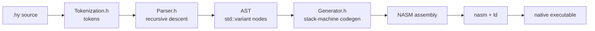

<div align="center">

```
 _   _       _
| | | |_   _| |    __ _ _ __   __ _
| |_| | | | | |   / _` | '_ \ / _` |
|  _  | |_| | |__| (_| | | | | (_| |
|_| |_|\__, |_____\__,_|_| |_|\__, |
       |___/                  |___/
``` 

# HyLang 

### A tiny, number-loving language that compiles straight to x86-64 assembly.
### Built-in primes, palindromes, Fibonacci, GCD, **arrays**, loops and more. Source files end in `.hy`.


[📘 Documentation](DOCUMENTATION.md) ·
[🧾 Syntax Cheat Sheet](SYNTAX.md) ·
</div>

> **HyLang** is a working name for the language whose files end in `.hy`. Note that an unrelated Lisp dialect on Python is also called "Hy", so you may want a more distinctive name before publishing. The compiler itself is the `CompilerProg` project.

---  

## 📑 Table of Contents

- [Why HyLang?](#-why-hylang)
- [Feature Overview](#-feature-overview)
- [Quick Look](#-quick-look)
- [Build and Run](#-build-and-run)
- [Language Basics](#-language-basics)
- [📦 Arrays](#-arrays)
- [Control Flow](#-control-flow)
- [Operators and Precedence](#-operators-and-precedence)
- [Built-in Function Library](#-built-in-function-library)
- [Examples](#-examples)
- [How It Works](#️-how-it-works)
- [Project Structure](#-project-structure)
- [Gotchas](#️-gotchas)
- [Error Messages](#-error-messages)
- [Contributing](#-contributing)
- [FAQ](#-faq)
- [License](#-license)

---

## ✨ Why HyLang?

Most languages make you `import math` just to check whether a number is prime. HyLang ships the fun stuff **as built-in functions**, has proper **arrays**, and turns your program into **real machine code** through NASM, with no interpreter or runtime.

```text
print(gcd(48, 18));
print(prime(97));
print(digit_sum(2024));
```

Output:

```text
6
1
8
```

It is also a compact codebase for **learning how compilers work**: a tokenizer, a recursive-descent parser, an `std::variant` AST and a stack-machine code generator, all in plain C++ with no dependencies.

---

## 🌟 Feature Overview

| | Feature | Details |
|:-:|---|---|
| 🧮 | **21 built-in functions** | primes, palindromes, Fibonacci, GCD, factorial, sqrt, power, random, UTC time and more |
| 📦 | **Arrays** | literals, fixed-size declarations, indexing, element assignment, `len()` and a runtime bounds check |
| 🔁 | **Loops** | range-based `for (i = a to b)` (the upper bound is exclusive) |
| 🔀 | **Branching** | `if` / `else`; any non-zero value counts as true |
| 🔤 | **Literals** | integers, doubles (parsed) and strings (printable) |
| ⌨️ | **Input** | `input().int` reads a signed integer from standard input |
| 🧱 | **Expressions** | `+ - * /`, six comparison operators and parentheses |
| 🚪 | **Exit codes** | `exit(code);` |
| 🧬 | **Native output** | generates NASM assembly using Linux syscalls |
| 🪶 | **Zero dependencies** | just the C++ standard library |

---

## 🚀 Quick Look

`hello.hy`:

```text
let n = input().int;

if (prime(n)) {
    print("prime");
} else {
    print("not prime");
}
```

And with arrays:

```text
let a = [4, 8, 15, 16, 23, 42];

for (i = 0 to len(a)) {
    print(a[i] * 2);
}
```

Output:

```text
8
16
30
32
46
84
```

---

## 🧰 Build and Run

### 1. Build the compiler

HyLang uses C++20 (designated initializers and `std::bit_cast`). Open the project in CLion, or from a terminal:

```bash
cmake -S . -B cmake-build-debug
cmake --build cmake-build-debug
```

| Compiler | Minimum version |
|---|---|
| GCC | 11 |
| Clang | 14 |
| MSVC | 19.28 (VS 2019 16.8) |

### 2. Compile a `.hy` program

```bash
CompilerProg.exe test.hy        # Windows
./CompilerProg test.hy          # Linux / macOS
```

This runs the tokenizer, parser and generator and produces **NASM assembly**. A successful compile prints nothing and exits with code `0`.

> 🔎 VERIFY: say which file `main.cpp` writes the assembly to (for example `out.asm`) and update the commands below.

### 3. Assemble, link and run (Linux or WSL)

The generated code uses Linux x86-64 syscalls, so the final steps must run on **Linux or WSL**:

```bash
nasm -f elf64 out.asm -o out.o
ld out.o -o out
./out
echo $?          # the program's exit code
```

You need `nasm` and `ld` installed (`sudo apt install nasm binutils`). The `random` built-in uses the CPU's `rdrand` instruction.

---

## 📚 Language Basics

### Values

| Kind | Example | Status |
|---|---|---|
| Integer | `42` | the main type: **64-bit signed** |
| String | `"hello"` | can be printed directly with `print("...")` |
| Double | `3.14` | parsed, but arithmetic is integer-only (see [Known Issues](docs/DOCUMENTATION.md#13-known-issues-and-fixes)) |

### Variables

```text
let x = 10;
let y = x * 2 + 1;
```

- Every variable is declared once with `let`.
- Declaring a name that is already in scope is a **compile error** (`identifier already used`).
- Using a name before it is declared is a compile error (`undeclared identifier`).
- Variables declared inside an `if` or `for` block disappear when the block ends.

### Statements at a glance

| Statement | Example |
|---|---|
| Print | `print(x + 1);` |
| Exit | `exit(0);` |
| Variable | `let x = 10;` |
| Array literal | `let a = [1, 2, 3];` |
| Array of size N | `let a[5];` |
| Array assign | `a[0] = 99;` |
| If / else | `if (x > 3) { ... } else { ... }` |
| For loop | `for (i = 0 to 9) { ... }` |

Every statement ends with `;`, except `if` and `for`, which end with a `{ }` block.

### Comments

HyLang has **no comment syntax yet**. A `//` would be read as two division signs. Adding comments is a five-line change to the tokenizer; see [Known Issues](docs/DOCUMENTATION.md#13-known-issues-and-fixes).

---

## 📦 Arrays

Arrays are one-dimensional lists of 64-bit integers stored on the stack. HyLang supports **creating, reading, writing and measuring** them, and it checks every access at runtime.

### Creating arrays

**1. With values (array literal)**

```text
let primes = [2, 3, 5, 7, 11];
```

Elements can be any expressions:

```text
let mixed = [1 + 1, power(2, 3), fact(4)];
```

**2. With a fixed size** (all elements start at `0`)

```text
let buffer[10];
```

The size **must be an integer literal**. `let buffer[n];` is not allowed.

### Reading, writing, measuring

```text
let a = [10, 20, 30];
print(a[0]);
print(a[1 + 1]);
a[1] = 99;
a[0] = a[1] + 1;
print(len(a));
print(a[len(a) - 1]);
```

Output:

```text
10
30
3
30
```

### Looping over an array

`to` is **exclusive**, so loop from `0` to `len(a)` to visit every element:

```text
let a = [4, 8, 15, 16, 23, 42];

for (i = 0 to len(a)) {
    print(a[i]);
}
```

### Filling an array in a loop

```text
let squares[10];

for (i = 0 to 10) {
    squares[i] = i * i;
}

print(squares[5]);
```

Output:

```text
25
```

### Array syntax summary

| Operation | Syntax | Notes |
|---|---|---|
| Create with values | `let a = [1, 2, 3];` | at least one element |
| Create with size | `let a[5];` | size must be an integer literal; filled with 0 |
| Read | `a[i]` | `i` is any expression |
| Write | `a[i] = expr;` | |
| Length | `len(a)` | argument must be an array name; known at compile time |

### Array rules and limits

- Arrays are **one-dimensional** and hold integers.
- An empty literal `[]` is rejected with *"empty array literal"*.
- `len(...)` takes an array **name**, not an expression.
- **Out-of-range access** (negative or `>= len`) makes the program exit immediately with **exit code 1** and no message.
- Arrays live on the stack and follow the same block scoping as other variables.
- Array elements can be reassigned. This is also the way to keep a "running" value, because plain variables have no assignment statement yet (see the [running maximum recipe](#running-maximum-the-arrays-as-variables-trick)).

---

## 🔀 Control Flow

### If / else

```text
let score = 82;

if (score >= 90) {
    print(1);
} else {
    if (score >= 80) {
        print(2);
    } else {
        print(3);
    }
}
```

Braces are mandatory. There is no `else if`, so nest an `if` inside the `else` block. A condition is true when its value is **non-zero**.

### For loops

```text
for (i = 1 to 5) {
    print(i);
}
```

Output:

```text
1
2
3
4
```

- The loop runs while `i < end`, so **the end value is not included**.
- The end expression is evaluated **once**, before the loop starts.
- The loop variable is a normal variable, visible only inside the loop.
- Loops only count upwards. If `start >= end`, the body never runs.

### Exiting early

```text
for (i = 2 to 100) {
    if (prime(i) == 0) {
        exit(1);
    }
}
```

---

## ➗ Operators and Precedence

| Level | Operators | Associativity |
|:-:|---|---|
| 1 (loosest) | `==` `!=` `<` `>` `<=` `>=` | left |
| 2 | `+` `-` | left |
| 3 | `*` `/` | left |
| 4 (tightest) | literals, names, `a[i]`, calls, `( )` | n/a |

```text
print(1 + 2 * 3);
print((1 + 2) * 3);
print(1 + 2 < 2 * 3);
```

Output: `7`, `9`, `1`.

Comparisons produce `1` (true) or `0` (false). `/` is **signed integer division**; dividing by zero crashes the program.

Not supported yet: `%`, unary `-` (write `0 - 5`), `&&`, `||`, `!`.

---

## 🧮 Built-in Function Library

All values are 64-bit signed integers.

### Math

| Function | Meaning | Example |
|---|---|---|
| `abs x` | absolute value | `abs(0 - 7)` gives 7 |
| `sqrt(x)` | integer square root (rounded down; 0 for `x <= 0`) | `sqrt(80)` gives 8 |
| `power(a, b)` | a to the power b | `power(2, 10)` gives 1024 |
| `fact(x)` | factorial (1 for `x <= 1`) | `fact(5)` gives 120 |
| `gcd(a, b)` | greatest common divisor | `gcd(48, 18)` gives 6 |
| `max(a, b)` | larger of two | `max(3, 9)` gives 9 |
| `min(a, b)` | smaller of two | `min(3, 9)` gives 3 |
| `sum a, b, ...` | total of 2 or more values | `sum 1, 2, 3` gives 6 |
| `mid_val x` | half of `x`, rounded toward zero | `mid_val(9)` gives 4 |

### Number theory

| Function | Meaning | Example |
|---|---|---|
| `prime(x)` | 1 if prime, else 0 | `prime(13)` gives 1 |
| `even x` | **1 if even**, 0 if odd | `even(10)` gives 1 |
| `palindrome(x)` | 1 if the digits read the same both ways (0 for negatives) | `palindrome(121)` gives 1 |
| `n_fibonacci x` | n-th Fibonacci number, with F(0) = 0 and F(1) = 1 | `n_fibonacci(10)` gives 55 |

### Digits

| Function | Meaning | Example |
|---|---|---|
| `digit_sum x` | sum of digits (sign ignored) | `digit_sum(123)` gives 6 |
| `count_digits(x)` | number of digits (`0` counts as 1) | `count_digits(1234)` gives 4 |

### Logic, random, time and input

| Function | Meaning | Example |
|---|---|---|
| `equal(a, b)` | 1 if equal, else 0 | `equal(3, 3)` gives 1 |
| `random(a, b)` | random integer from `a` to `b`, **both inclusive** (0 if `a > b`) | `random(1, 6)` |
| `time_utc()` | current UTC time as **Unix seconds** | `time_utc()` |
| `input().int` | read a signed integer from stdin (0 if empty) | `let n = input().int;` |

### Arrays

| Function | Meaning | Example |
|---|---|---|
| `len(a)` | number of elements | `len(a)` |
| `a[i]` | element access | `a[0]` |

> 💡 **Tip:** `abs`, `even`, `mid_val`, `digit_sum` and `n_fibonacci` take a single value, so write `abs(x - 5)` with parentheses whenever the operand is more than one token. See [Gotchas](#️-gotchas).

> 🔒 **Reserved names:** every function name above is a keyword, so you cannot call a variable `sum`, `max`, `min`, `power`, `random`, `equal`, `fact`, `prime`, `even`, `abs` and so on.

---

## 🎮 Examples

Examples print numbers because `print` of a string does not add a newline (see [Known Issues](docs/DOCUMENTATION.md#13-known-issues-and-fixes)).

### Hello world

```text
print("Hello, world!");
```

### Prime tester

```text
let n = input().int;
print(prime(n));
```

### Hypotenuse calculator

```text
print(sqrt(power(3, 2) + power(4, 2)));
```

Output: `5`

### Factorials from 1 to 10

```text
for (i = 1 to 11) {
    print(fact(i));
}
```

### Fibonacci sequence

```text
for (i = 0 to 15) {
    print(n_fibonacci(i));
}
```

Output: `0 1 1 2 3 5 8 13 21 34 55 89 144 233 377` (one per line).

### Palindromes between 100 and 200

```text
for (n = 100 to 201) {
    if (palindrome(n)) {
        print(n);
    }
}
```

### Running maximum: the "arrays as variables" trick

Plain variables can't be reassigned yet, so keep the running value in an array:

```text
let a = [3, 9, 2, 7, 5];
let m[5];
m[0] = a[0];
for (i = 1 to 5) {
    m[i] = max(m[i - 1], a[i]);
}
print(m[4]);
```

Output: `9`

### Running total with arrays

```text
let nums = [5, 10, 15, 20];
let total[4];
total[0] = nums[0];
for (i = 1 to 4) {
    total[i] = total[i - 1] + nums[i];
}
print(total[3]);
```

Output: `50`

### Primes inside an array

```text
let nums = [10, 11, 12, 13, 14, 15, 16, 17];
for (i = 0 to len(nums)) {
    if (prime(nums[i])) {
        print(nums[i]);
    }
}
```

Output: `11`, `13`, `17`.

### GCD of two array elements

```text
let v = [84, 36, 12];
print(gcd(v[0], v[1]));
```

Output: `12`

### Guess the number

```text
let secret = random(1, 10);
print("Guess a number from 1 to 10: ");
let guess = input().int;
if (equal(secret, guess)) {
    print("Correct!");
} else {
    print("Wrong, it was ");
    print(secret);
}
```

### Even / odd report

```text
for (i = 1 to 11) {
    print(even(i));
}
```

Output: `0 1 0 1 ...` (1 means even).

### Digit statistics

```text
let n = 9875;
print(count_digits(n));
print(digit_sum(n));
```

Output: `4` then `29`.

---

## 🏗️ How It Works



### The stack-machine model

The generator keeps every value on the machine stack:

- Each expression **leaves exactly one value** on top of the stack.
- Binary operators generate the left side, then the right side, pop both, compute, and push the result.
- A variable is simply a stack slot, tracked by the compiler in a name-to-slot map.
- An array is a run of consecutive slots; `len` is known at compile time.
- Leaving a block pops everything declared inside it, which gives block scoping for free.

### The parser

One function per precedence level:

```
parse_expr
  └─ parse_comparison      == != < > <= >=
      └─ parse_additive    + -
          └─ parse_multiplicative   * /
              └─ parse_primary      literals, names, a[i], calls, ( )
```

The three `let` forms are told apart with lookahead:

| Tokens after `let` | Form |
|---|---|
| `name = [` | array literal |
| `name [` | sized array |
| `name =` | scalar variable |

### The AST

```cpp
struct NodeExpression {
    std::variant<NodeIntLiteral, NodeIntIdentifier, NodeSum, NodeBinary,
                 NodeArrayIndex, NodeLen, /* ...and the rest */> var;
};
```

---

## 📂 Project Structure

```
CompilerProg/
├── CMakeLists.txt
├── main.cpp             entry point: reads the .hy file and drives the pipeline
├── Tokenization.h       source text  -> tokens
├── Parser.h             tokens       -> AST
├── Generator.h          AST          -> NASM assembly
├── test.hy              sample program
├── README.md
└── docs/
    ├── DOCUMENTATION.md
    └── SYNTAX.md
```

---

## ⚠️ Gotchas

| Pitfall | Details |
|---|---|
| **`to` is exclusive** | `for (i = 1 to 5)` runs for 1, 2, 3, 4. Loop over an array with `0 to len(a)`. |
| **No comments** | `//` is not a comment. Leave comments out of `.hy` files for now. |
| **No unary minus** | `print(-5);` fails. Write `0 - 5`. |
| **Negative numbers print wrongly** | `print` treats values as unsigned, so `print(0 - 5)` shows a huge number. See Known Issues. |
| **No plain reassignment** | `x = x + 1;` is a syntax error, and a second `let x` is a compile error. Use an array element. |
| **Prefix functions grab one value** | `abs 3 - 10` is `(abs 3) - 10`. Use `abs(3 - 10)`. |
| **`sum` is greedy** | It eats every following `, value`. Wrap it: `max((sum 1, 2), 3)`. |
| **No `else if`** | Nest an `if` inside `else { }`. |
| **Array size must be a literal** | `let a[n];` is a syntax error. |
| **`input()` needs `.int`** | Write `input().int`. |
| **Strings are print-only** | `print("text")` works. Storing a string in a variable and printing it shows an address. |
| **Function names are reserved** | You can't name a variable `max`, `sum`, `power`, `random` and so on. |
| **Chained comparisons** | `1 < 2 < 3` means `(1 < 2) < 3`. |

---

## 🚨 Error Messages

Errors are printed to `stderr` and the compiler exits with a failure code.

| Message | Stage | Cause |
|---|---|---|
| `Unexpected character! Invalid input: X` | tokenizer | a character HyLang doesn't know (`%`, `&`, `#`, ...) |
| `Unexpected '!': expected '!='` | tokenizer | a lone `!` |
| `Error: Unterminated string!` / `Missing closing quote!` | tokenizer | unclosed `"` |
| `Error: Invalid escape sequence!` | tokenizer | only `\n \t \" \\` are allowed |
| `Syntax error: expected ';'` | parser | missing semicolon |
| `Syntax error: expected '(' after print` | parser | wrote `print 5;` |
| `Syntax error: expected '{'` / `'}'` | parser | missing or unclosed block |
| `Syntax error: expected array size` | parser | `let a[n];` instead of a literal |
| `Syntax error: empty array literal` | parser | `let a = [];` |
| `Syntax error: expected '.' after input()` | parser | `input()` without `.int` |
| `Syntax error: sum requires at least two values` | parser | `sum 5;` |
| `Syntax error: unexpected token` | parser | a token that cannot start a statement (for example `x = 5;`) |
| `Error: undeclared identifier: x` | generator | used before `let`, or out of scope |
| `Error: undeclared array: a` | generator | indexing something that isn't an array |
| `Error: identifier already used: x` | generator | second `let x` in scope |

The complete list is in the [documentation](docs/DOCUMENTATION.md#11-error-reference).

---

## 🤝 Contributing

1. Fork the repo
2. Create a branch: `git checkout -b feature/my-builtin`
3. Make your change (see *Adding a built-in* in the [docs](docs/DOCUMENTATION.md#124-adding-a-new-built-in-step-by-step))
4. Open a pull request

**Good first contributions:** comment support, fixing the known issues, a new built-in function, example programs, tests.

---

## ❓ FAQ

**What does the compiler output?**
NASM assembly for Linux x86-64. Assemble it with `nasm -f elf64` and link with `ld`.

**Why did the compiler print nothing and exit with code 0?**
That is success. Compiling only generates assembly; run the assembled program separately.

**Does it run on Windows?**
The compiler does. The generated program needs Linux (or WSL) because it uses Linux syscalls.

**Does HyLang have arrays?**
Yes. Literals, fixed-size arrays, indexing, assignment, `len()` and a runtime bounds check.

**Is the end of a `for` range included?**
No. `for (i = 0 to 3)` gives 0, 1, 2.

**Can I make an array with a variable size?**
Not yet. The size must be an integer literal.

**How do I get a negative number?**
`0 - n`, or read one with `input().int`.

**Can `max` take three values?**
Nest it: `max(a, max(b, c))`.

---

## 📜 License

**Falcon Compiler** is open-source software released under the [MIT License](LICENSE).

Copyright © 2026 Falcon Compiler Contributors

<div align="center">

**If you like this project, give it a ⭐**

Made with ☕ and a lot of `std::optional`.

</div>
